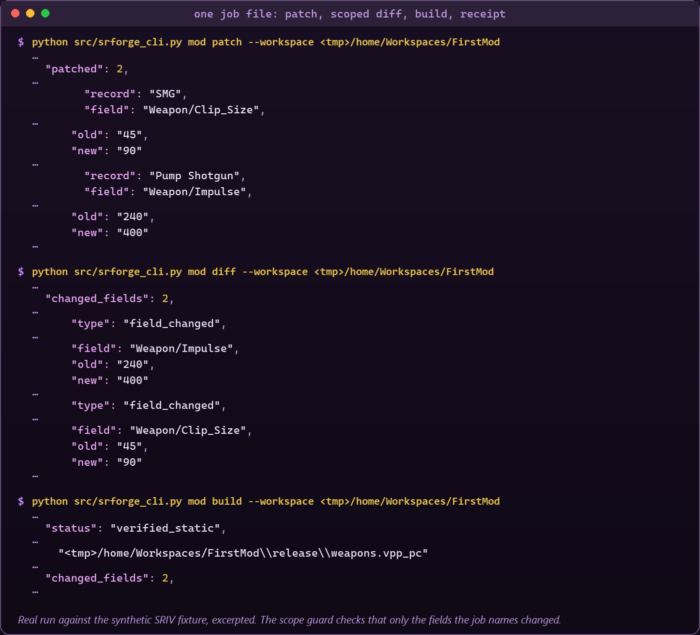
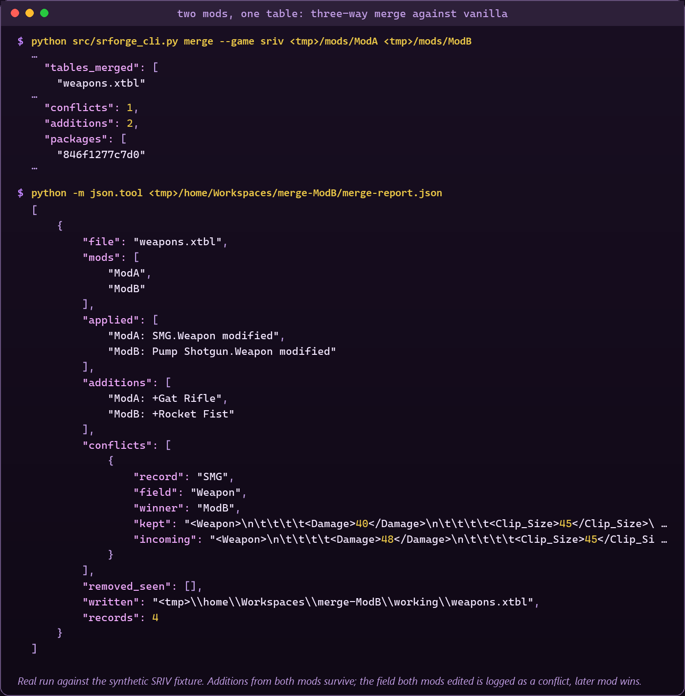
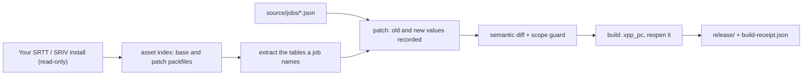

<div align="center">


[](https://github.com/SenjuWoo/SaintsRowForge/actions/workflows/tests.yml)
[](https://github.com/SenjuWoo/SaintsRowForge/releases/latest)
[](https://www.python.org/downloads/)
[](src/srforge)
[](LICENSE)

**[Install](#install)** · **[First mod](#your-first-mod)** · **[Commands](#commands)** · **[Status](#what-works)** · **[Merging](#merging-mods)** · **[MCP](#mcp-server)** · **[How it works](#how-it-works)** · **[Changelog](CHANGELOG.md)**

</div>

Saints Row Forge is a modding workbench for **Saints Row: The Third** (PC) and
**Saints Row IV** (PC) that people and AI agents can both drive. It reads the
game's packfiles with its own Python engines (VPP, XTBL, ASM, strings), applies
your table edits from a small job file, checks that nothing else changed, and
builds an installable `.vpp_pc` with a SHA-256 receipt. Your game folder is
never written. Use it from the CLI or from any MCP-capable agent (Hermes,
Claude Desktop, Codex, ...).

## What you get

- **Native formats, no external tools.** VPP packfiles (SRTT v06 and SRIV v0A, condensed and compressed), XTBL tables, ASM containers with str2 size updates, and `le_strings` files are read and written in pure Python.
- **Edits as data.** A job file says "multiply this field by 1.25" or "set that one to 450". The forge pulls the right table out of the right packfile (patch packfiles win over base ones, as in the game), applies the job and records old and new values.
- **A scope guard.** The semantic diff after every patch must only touch the records and fields the job names. Anything else fails the build instead of shipping.
- **A mod merger.** Two mods that ship their own copy of the same table normally means last one wins. `merge` three-way merges every `.xtbl` against vanilla, keeps both mods' additions and logs real conflicts.
- **Receipts.** Every build reopens its own packages, hashes inputs and outputs, and writes `build-receipt.json`.
- **Honest status.** `doctor` and the capability matrix say `native`, `external_verified`, `manual` or `unsupported` per format. Textures, meshes, audio and Workshop are reported as unsupported, not faked.


## Install

**You need:** Windows 10/11, [Python](https://www.python.org/downloads/) 3.10+,
and Saints Row: The Third and/or Saints Row IV (Steam, PC).

1. Download the zip from the [latest release](https://github.com/SenjuWoo/SaintsRowForge/releases/latest) and unzip it anywhere.
2. Right-click `Install.ps1` and choose **Run with PowerShell** (no admin needed). It installs to `%LOCALAPPDATA%\SaintsRowForge` and runs `doctor` on the result.
3. Double-click `START-HERE.bat` whenever you want status and help.

`Install.ps1` stages the new code beside the live install, moves the old code to
a timestamped backup and restores it if activation or `doctor` fails.
Workspaces, Inbox, logs and `tools_vault` are never touched by the swap.
`Update.ps1` and `Uninstall.ps1` ship alongside it.

Prefer git? Clone and run straight from source; the commands are the same with
the checkout's `src\srforge_cli.py`:

```bat
git clone https://github.com/SenjuWoo/SaintsRowForge
cd SaintsRowForge
python src\srforge_cli.py doctor
```

The forge finds games through your Steam libraries. For a copy somewhere else,
point it at the folder per game (each variable only affects its own game):

```bat
set SRFORGE_GAME_SRTT=D:\Games\Saints Row The Third
set SRFORGE_GAME_SRIV=D:\Games\Saints Row IV
```

`SRFORGE_HOME` moves the forge's data folder (Workspaces, Inbox, tools_vault)
away from `%LOCALAPPDATA%\SaintsRowForge`.

There is no `srforge` launcher on PATH: below, `srforge` stands for
`python %LOCALAPPDATA%\SaintsRowForge\src\srforge_cli.py` (installed) or
`python src\srforge_cli.py` (checkout).

## Your first mod

One weapon stat, fully receipted:

```bat
set CLI=%LOCALAPPDATA%\SaintsRowForge\src\srforge_cli.py
python %CLI% doctor
python %CLI% mod new MyFirstMod --game sriv
```

Create `%LOCALAPPDATA%\SaintsRowForge\Workspaces\MyFirstMod\source\jobs\weapons.json`:

```json
{"operations": [
  {"operation": "multiply", "file": "weapons.xtbl",
   "record": "SMG-Storm", "field": "Magazine_Size", "value": 1.25}
]}
```

```bat
python %CLI% mod patch --workspace %LOCALAPPDATA%\SaintsRowForge\Workspaces\MyFirstMod
python %CLI% mod diff  --workspace %LOCALAPPDATA%\SaintsRowForge\Workspaces\MyFirstMod
python %CLI% mod build --workspace %LOCALAPPDATA%\SaintsRowForge\Workspaces\MyFirstMod
```

The finished mod is in `Workspaces\MyFirstMod\release\`, reopen-verified and
SHA-256 receipted. Your game files were never touched.

A job file holds a list of operations: `set`, `multiply`, `add` or
`clone_record`. Nested fields use a path such as `Weapon/Damage`:

```json
{"operations": [
  {"operation": "set", "file": "weapons.xtbl",
   "record": "Pistol-Revolver", "field": "Ragdoll_Force_Shoot", "value": 450},
  {"operation": "multiply", "file": "weapons.xtbl",
   "record": "SMG-Storm", "field": "Magazine_Size", "value": 1.25}
]}
```

`multiply` keeps whole numbers whole, but a fractional result is written as a
decimal (45 x 1.25 = 56.25). Pick factors that suit the field, or use `set`.



### Installing your finished mod

The forge deliberately never writes your game directory. The built `.vpp_pc`
installs the same way as any other table mod for your game. Current
manual-install guides are linked in
[`knowledge/07-ONLINE-GUIDE-LINKS.md`](knowledge/07-ONLINE-GUIDE-LINKS.md).

## Commands

| Need | Command |
|---|---|
| Find installed games | `srforge discover` |
| Full health report: games, asset index, capabilities, tools | `srforge doctor` |
| Which packfile holds a file | `srforge asset find <part> --game sriv` · `asset origin <name> --game sriv` |
| Pull a file into a workspace | `srforge asset extract --name <file> --workspace <ws> --game sriv` |
| Read one table value from the game | `srforge xtbl query --file weapons.xtbl --record <r> --field <f> --game sriv` |
| New workspace | `srforge mod new <name> --game srtt\|sriv` (or `project new`) |
| Check a workspace's jobs | `srforge project validate <ws>` |
| Apply jobs, show the semantic diff, build | `srforge mod patch\|diff\|build --workspace <ws>` |
| Merge mods that share tables | `srforge merge --game sriv <modA> <modB> ...` |
| Register third-party tools | `srforge deps import` · `deps status` |

Exit codes: `0` ok · `1` generic · `2` validation · `3` not found ·
`4` dependency · `5` refused. `--json` works on every command.

## What works

Verified on real Steam installs of both games when the engines were built:

| Area | SRTT | SRIV |
|---|---|---|
| Game detection + asset index | ✅ 21k files | ✅ 23k files |
| VPP packfiles | ✅ native v06 reader/writer | ✅ native v0A reader/writer |
| XTBL parse/query/patch/diff | ✅ | ✅ |
| ASM inspect/update (str2 sizes) | ✅ | ✅ byte-perfect round-trip vs vanilla |
| le_strings extract/build | ✅ | ✅ |
| Lua static lint | ✅ | ✅ |
| Cross-mod table **merge** (mod manager) | ✅ | ✅ |
| PEG/CPEG textures / meshes / audio / workshop | ❌ not implemented (reported `unsupported`) | ❌ not implemented (reported `unsupported`) |

The capability matrix (`srforge doctor`, `sr_capabilities`) is the source of
truth: its statuses always reflect what this build actually contains.

## Merging mods

Saints Row mods ship full copies of shared tables, so installing two mods that
touch the same table normally means last-one-wins data loss. The forge
three-way merges every `.xtbl` against vanilla instead:

```bat
srforge merge --game sriv "C:\path\to\ModA" "C:\path\to\ModB"
```

- records added by either mod: both survive
- distinct edits to different fields: all applied
- two mods editing the same field: **conflict logged** in `merge-report.json`
  (later-listed mod wins; every value is kept in the report)
- non-table file collisions (`.str2_pc`, `.asm_pc`, ...): flagged, later wins

A "field" here is a direct child element of a record. Two mods that change
different values inside the same parent element (say both under `<Weapon>`)
count as editing the same field, and the conflict is logged. Vanilla archives
are **never written**; every merge builds into a new workspace.



## MCP server

No dependencies; a small stdio JSON-RPC server:

```bat
python mcp_server\server.py
```

13 typed tools: `sr_doctor sr_game_detect sr_capabilities sr_knowledge_search
sr_asset_search sr_asset_origin sr_asset_extract sr_xtbl_query sr_project_new
sr_mod_patch sr_mod_diff sr_mod_build sr_conflicts`.

`sr_knowledge_search` queries the additive `knowledge/` reference layer (format
notes, SDK adapter recipes, an upstream source map with provenance). It is
evidence for research, never proof of a capability; the capability matrix stays
authoritative. [AI-INTEGRATION.md](AI-INTEGRATION.md) covers client setup and
[AI-KNOWLEDGE.md](AI-KNOWLEDGE.md) the knowledge layer.

## How it works



- **Standard library only.** No runtime dependencies, no network, no daemon.
- **Precedence like the game.** When a file exists in several packfiles, the patch packfile wins; `asset origin` shows every copy and which one counts.
- **Third-party tools are never redistributed.** Drop downloads into `%LOCALAPPDATA%\SaintsRowForge\Inbox` (or `inbox/` in a checkout) and run `deps import`. Provenance (source URL + SHA-256) is pinned in `tools_vault/manifest.json`, and execution refuses unregistered binaries. See [THIRD-PARTY-NOTICES.md](THIRD-PARTY-NOTICES.md).

## Tested

```bat
python tests\run_tests.py
powershell -NoProfile -ExecutionPolicy Bypass -File tests\Test-Installer.ps1
```

The suite runs 19 checks with no pytest and no game assets: format round-trips,
packfile precedence, failure paths, the scope guard, the merge engine and an
end-to-end CLI run against synthetic SRTT/SRIV-layout fixtures
(`tests/fixtures.py`). The installer tests cover fresh install, data
preservation, rollback and the uninstalled case. Both run in CI on Windows.
The screenshots above are real runs against those fixtures; real-install
validation is separate (`doctor` plus the first-mod flow on live Steam installs
of both games).

## License

[MIT](LICENSE). Saints Row is a trademark of its owners. This project is unofficial.
